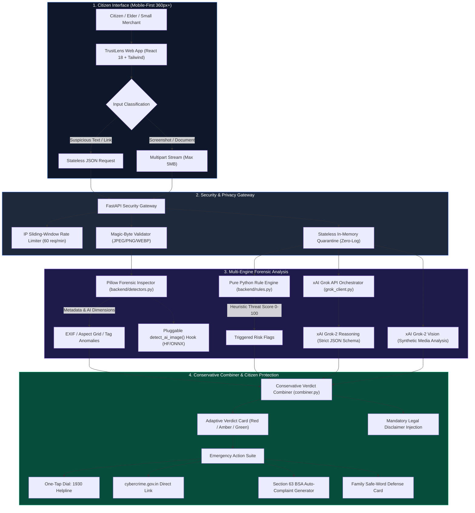
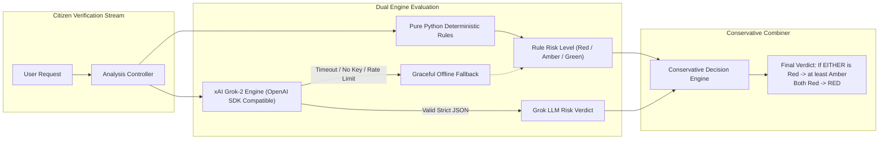

# 🛡️ TrustLens: Mobile-First Citizen Cyber Resilience & Scam Shield Platform
### *Seva First Innovation Challenge 2026 — Flagship Responsible AI & Digital Trust Solution*

---

```
████████╗██████╗ ██╗   ██╗███████╗████████╗██╗     ███████╗███╗   ██╗███████╗
╚══██╔══╝██╔══██╗██║   ██║██╔════╝╚══██╔══╝██║     ██╔════╝████╗  ██║██╔════╝
   ██║   ██████╔╝██║   ██║███████╗   ██║   ██║     █████╗  ██╔██╗ ██║███████╗
   ██║   ██╔══██╗██║   ██║╚════██║   ██║   ██║     ██╔══╝  ██║╚██╗██║╚════██║
   ██║   ██║  ██║╚██████╔╝███████║   ██║   ███████╗███████╗██║ ╚████║███████║
   ╚═╝   ╚═╝  ╚═╝ ╚═════╝ ╚══════╝   ╚═╝   ╚══════╝╚══════╝╚═╝  ╚═══╝╚══════╝
                     RESPONSIBLE AI & DIGITAL TRUST FORENSIC SUITE
```

<div align="center">

[](https://opensource.org/licenses/Apache-2.0)
[](https://python.org)
[](https://fastapi.tiangolo.com)
[](https://react.dev)
[](https://www.typescriptlang.org)
[](https://tailwindcss.com)
[](https://x.ai)
[](https://www.iso.org/standard/44381.html)
[](#)

</div>

---

## 📌 Executive Summary

Modern cyber fraud syndicates increasingly exploit social engineering, AI-generated synthetic media, and institutional impersonation to target ordinary citizens, senior citizens, rural households, and small traders. Across India and particularly in high-density commercial corridors:

1. **Digital Arrest & Police Extortion Schemes** trap victims via fake CBI, Mumbai Police, and Customs video-interrogation threats.
2. **Critical Infrastructure Disconnection Notices** (e.g., Mahavitaran/MSEDCL power cuts, SBI/HDFC YONO KYC locks) instill artificial urgency to force malicious APK or remote-access downloads.
3. **AI Voice-Cloning & Deepfake Impersonations** simulate family distress emergencies to extract rapid UPI transfers.
4. **Existing Security Tools Lack Accessibility**: They present impenetrable technical jargon, require costly enterprise licenses, or compromise privacy by logging sensitive citizen communications.

**TrustLens** is a unified, mobile-first forensic verification suite engineered for the **Seva First Innovation Challenge 2026** (Theme: *Responsible AI, Deepfake Detection, Cyber Resilience & Digital Trust*). It delivers:

- **Dual-Layer Hybrid Verification**: A deterministic multi-vector Rule Engine operating alongside **xAI Grok-2 LLM Reasoning**.
- **Conservative Verdict Synthesis**: A safety-first rule ensuring that if *either* system flags critical risk, the citizen is cautioned immediately.
- **Deep Multimodal Image Forensics**: Magic-byte inspection, Pillow EXIF metadata forensic decomposition, AI generation grid matching, and Grok Vision anomaly detection.
- **Zero-Data-Storage Architecture**: 100% stateless processing in transient memory without database persistence or message content logging.
- **Emergency Action Suite**: Instant one-tap dialing to the **National Cyber Helpline 1930**, automated structured police complaint drafting, and the innovative **Family Safe-Word Defense** against AI voice-clone fraud.

---

## 🏗️ System Architecture & Dataflow



---

## 📊 Comprehensive Threat Signal Matrix

TrustLens evaluates communications against seven high-impact cyber threat categories engineered specifically for current fraud vectors:

| # | Threat Category | Target Attack Vectors | Weighted Heuristic Flags | Forensic Indicators & Detection Rules |
|---|---|---|---|---|
| **1** | **Digital Arrest & Police Extortion** | Impersonation of CBI, Mumbai Police Cyber Cell, Customs, NCB, TRAI | `digital_arrest_law_enforcement` (Weight: 45) | Threats of non-bailable warrants, Skype/video interrogation mandates, seized contraband/narcotics parcels |
| **2** | **Infrastructure & Account Lock** | MSEDCL electricity cutoffs, SBI/HDFC YONO account freezes, SIM deactivations | `fake_kyc_account_electricity_block` (Weight: 35) | "Disconnected tonight at 9:30 PM", mandatory immediate PAN/Aadhaar re-verification, urgency traps |
| **3** | **Unrealistic Investment Fraud** | Guaranteed 300% stock returns, VIP crypto signals, SEBI insider trading leaks | `investment_crypto_stock_scam` (Weight: 40) | Promises of zero-risk high returns, double money schemes, private Telegram/WhatsApp pump groups |
| **4** | **Urgency & Coercive Secrecy** | High-pressure timers, warnings not to consult family members or authorities | `urgency_secrecy_pressure` (Weight: 25) | Deadlines within 1 to 2 hours, strict secrecy instructions ("do not inform family or local police") |
| **5** | **Remote Access & Credential Theft** | Malicious APK sideloading, AnyDesk, TeamViewer, QuickSupport, OTP theft | `remote_access_credentials_request` (Weight: 45) | Screen-sharing tool download coercion, requests for 9-digit remote codes, UPI collect requests, OTP harvesting |
| **6** | **Advance-Fee Task & Lottery Fraud** | Work-from-home YouTube video liking scams, UK lottery customs stamp fees | `lottery_job_advance_fee` (Weight: 35) | Daily earnings promises of ₹3,000–₹5,000 requiring "refundable registration fees" or airport clearance duties |
| **7** | **Adversarial URL & Phishing Links** | Punycode domains, raw IP hosts, URL shorteners, fake banking TLDs | `url_lookalike_phishing`, `url_suspicious_tld`, `url_ip_address` (Weights: 20-35) | Character substitution (xn--), suspicious TLDs (.xyz, .top, .buzz, .cc), unencrypted HTTP for banking forms |

---

## 🤖 Dual-Tier Hybrid AI & Fallback Architecture

To deliver sub-second response times without sacrificing forensic accuracy or creating cloud dependencies, TrustLens deploys an asynchronous hybrid analysis pipeline:



### 1. Deterministic Rule Engine (`backend/rules.py`)
- **Execution Speed**: < 10 milliseconds.
- **Coverage**: Regex patterns and linguistic heuristic tokens tuned to local dialects and Hinglish cyber fraud terms.
- **False-Positive Prevention**: Context-aware filters ignore security warnings in authentic bank OTP SMS messages (e.g., distinguishing "never share your OTP" from "send OTP to verify").

### 2. xAI Grok-2 Cognitive Reasoning (`backend/grok_client.py`)
- **API Endpoint**: `https://api.x.ai/v1` via official OpenAI Python SDK.
- **Model**: `grok-2-1212` for contextual text reasoning; `grok-2-vision-1212` for visual forensics.
- **Strict JSON Enforcement**: Direct `response_format={"type": "json_object"}` structured validation via Pydantic.
- **Resilient Fallback**: Automatic single retry on malformed JSON; seamless degradation to deterministic rules if API keys are unset or network timeouts occur.

### 3. Image Forensics & Pluggable Architecture (`backend/detectors.py`)
- **Magic-Byte Signature Verification**: Enforces valid file headers for JPEG (`FF D8 FF`), PNG (`89 50 4E 47`), and WEBP (`RIFF....WEBP`), rejecting disguised executable or polyglot files.
- **Pillow Metadata Analysis**: Detects absence of camera EXIF data, identifies image editing tool watermarks (Photoshop, Canva, Stable Diffusion), and matches exact generation grid dimensions (e.g., 512×512, 1024×1024, 1024×1792).
- **Pluggable Architecture Hook**: Includes `detect_ai_image()`, enabling zero-refactor integration of local Hugging Face or ONNX computer vision models.

---

## ⚖️ Evidentiary Standards & Legal Compliance

TrustLens is structured to maintain evidentiary integrity and support legal processes under Indian cyber law:

### 1. ISO/IEC 27037:2012 Compliance (Preservation & Handling)
- **Zero-Persistence Privacy**: No user text, phone numbers, or images are written to physical databases or disk storage.
- **In-Memory Volatile Processing**: Uploaded media exists solely within ephemeral RAM buffers and is permanently purged immediately after report generation.
- **Cryptographic Independence**: Eliminates the risk of user data leakage or unauthorized data mining.

### 2. Bharatiya Sakshya Adhiniyam (BSA), 2023 — Section 63
- Automatic synthesis of standardized incident summaries formatted for electronic record submission under Section 63:
  - Exact timestamp of message or media receipt.
  - Granular enumeration of detected risk indicators and deceptive patterns.
  - Preserved message excerpts with verified threat categorizations ready for submission to law enforcement officers.

### 3. Indian Evidence Act (IEA), 1872 — Section 65B
- Maintains backward-compatible forensic summaries to support evidentiary submissions under Section 65B certifications across legal proceedings.

---

## 📂 Repository Directory Layout

```
TrustLens/
├── backend/                      # Production FastAPI backend application
│   ├── combiner.py               # Conservative verdict synthesis logic
│   ├── detectors.py              # Pillow metadata forensic inspector & AI hook
│   ├── grok_client.py            # xAI Grok API integration & structured JSON handler
│   ├── main.py                   # FastAPI entrypoint, rate limiter & CORS middleware
│   ├── models.py                 # Pydantic data schemas & request/response contracts
│   ├── requirements.txt          # Python runtime dependencies
│   ├── rules.py                  # Pure Python 8-threat multi-lingual heuristic engine
│   └── tests/                    # Automated test suite (pytest)
│       ├── test_api.py           # Integration tests for REST endpoints
│       ├── test_combiner.py      # Decision tree combiner unit tests
│       └── test_rules.py         # Multi-lingual rule engine test cases
├── frontend/                     # Modern Investigator & Citizen UI (React 18 + Vite)
│   ├── index.html                # Responsive viewport root (360px+ support)
│   ├── package.json              # NPM dependencies & scripts
│   ├── postcss.config.js         # PostCSS configuration
│   ├── tailwind.config.js        # Custom Navy/Saffron theme definitions
│   ├── tsconfig.json             # TypeScript compiler settings
│   ├── vite.config.ts            # Vite build configuration & backend reverse proxy
│   └── src/
│       ├── App.tsx               # Main layout orchestrator
│       ├── i18n.ts               # Centralized localization definitions
│       ├── index.css             # Tailwind styling & animations
│       ├── main.tsx              # React DOM mounting entrypoint
│       └── components/
│           ├── ComingSoonTab.tsx # Polished placeholders for Voice & Video check
│           ├── Header.tsx        # Brand header with language switcher & badges
│           ├── ImageCheck.tsx    # Magic-byte upload & metadata visual inspector
│           ├── Navigation.tsx    # Mobile-first touch navigation tabs
│           ├── ResponsibleAIPage.tsx # 4-pillar algorithmic transparency overview
│           ├── SafetyReport.tsx  # Emergency actions, 1930 dialer & complaint copier
│           ├── TextCheck.tsx     # Message verification with live demo sample triggers
│           └── VerdictCard.tsx   # Adaptive Red/Amber/Green verdict component
├── samples/                      # Benchmark demonstration repository
│   ├── README.md                 # 5 recommended test image forensics guide
│   └── samples.json              # 10 realistic benchmark scam & safe scenarios
├── .env.example                  # Environment configuration template
├── .gitignore                    # Sensitive file & build artifact exclusion rules
├── README.md                     # Platform technical documentation (This file)
├── run_dev.bat                   # Unified one-click launch script (CMD)
└── run_dev.ps1                   # Unified one-click launch script (PowerShell)
```

---

## 🚀 Quick Start Guide

### 1. Prerequisites
- **Python**: 3.11 or 3.12
- **Node.js**: 18.0+ and `npm`
- **Optional API Key**: xAI Grok API Key (system functions automatically in offline rules mode without a key)

### 2. Environment Configuration
Create a `.env` file in the project root:
```bash
cp .env.example .env
```
Populate `.env` with your credentials:
```env
# xAI Grok API Configuration (Optional - Falls back to rules engine if empty)
XAI_API_KEY=your_xai_api_key_here
XAI_MODEL=grok-2-1212
XAI_VISION_MODEL=grok-2-vision-1212

# Server Configuration
BACKEND_HOST=127.0.0.1
BACKEND_PORT=8000
FRONTEND_ORIGIN=http://localhost:5173
```

---

### 3. Launch with One Command

#### Windows (PowerShell)
```powershell
.\run_dev.ps1
```

#### Windows (Command Prompt / Batch)
```cmd
run_dev.bat
```

---

### 4. Manual Launch (Step-by-Step)

#### Terminal 1 — FastAPI Backend Service
```powershell
# Create and activate virtual environment
python -m venv backend/.venv
backend\.venv\Scripts\Activate.ps1

# Install requirements
pip install -r backend/requirements.txt

# Start backend server
python -m uvicorn backend.main:app --host 127.0.0.1 --port 8000 --reload
```
*Backend interactive Swagger documentation will be live at `http://127.0.0.1:8000/docs`.*

#### Terminal 2 — React Frontend Workstation
```powershell
cd frontend
npm install
npm run dev
```
*Access the workstation interface at `http://localhost:5173`.*

---

## 🧪 Automated Test Verification

TrustLens includes comprehensive unit and integration test coverage across all forensic layers:

```powershell
backend\.venv\Scripts\python.exe -m pytest backend/tests -v
```

```
============================= test session starts =============================
platform win32 -- Python 3.12.4, pytest-9.2.0, pluggy-1.7.0
rootdir: C:\Users\Admin\Downloads\Projects\TrustLens
plugins: anyio-4.15.1, asyncio-1.4.1
collected 20 items

backend/tests/test_api.py::test_health PASSED                            [  5%]
backend/tests/test_api.py::test_get_samples PASSED                       [ 10%]
backend/tests/test_api.py::test_check_text_scam_marathi PASSED           [ 15%]
backend/tests/test_api.py::test_check_text_safe_hindi PASSED             [ 20%]
backend/tests/test_api.py::test_check_image_valid_jpeg PASSED            [ 25%]
backend/tests/test_api.py::test_check_image_invalid_magic_bytes PASSED   [ 30%]
backend/tests/test_combiner.py::test_both_red_yields_red PASSED          [ 35%]
backend/tests/test_combiner.py::test_either_red_yields_at_least_amber PASSED [ 40%]
backend/tests/test_combiner.py::test_both_green_yields_green PASSED      [ 45%]
backend/tests/test_combiner.py::test_fallback_when_grok_fails PASSED     [ 50%]
backend/tests/test_rules.py::test_digital_arrest_english PASSED          [ 55%]
backend/tests/test_rules.py::test_digital_arrest_marathi PASSED          [ 60%]
backend/tests/test_rules.py::test_fake_msedcl_marathi PASSED             [ 65%]
backend/tests/test_rules.py::test_fake_kyc_hindi PASSED                  [ 70%]
backend/tests/test_rules.py::test_stock_crypto_guaranteed PASSED         [ 75%]
backend/tests/test_rules.py::test_remote_access_anydesk PASSED           [ 80%]
backend/tests/test_rules.py::test_suspicious_urls PASSED                 [ 85%]
backend/tests/test_rules.py::test_legit_bank_otp_no_false_positive PASSED [ 90%]
backend/tests/test_rules.py::test_harmless_family_message_marathi PASSED [ 95%]
backend/tests/test_rules.py::test_harmless_family_message_hindi PASSED   [100%]

============================= 20 passed in 3.40s ==============================
```

---

## 🎯 Live Jury Demonstration Playbook

During competitive evaluations or jury reviews, execute the following workflow:

1. **Test Real-World Scenarios (One-Click Triggers)**:
   - On the **Message Check** tab, click **`Digital Arrest CBI Notice`** to demonstrate law enforcement threat detection and immediate red risk classification.
   - Click **`MSEDCL Power Disconnection`** to demonstrate utility cutoff fraud detection with localized advice.
   - Click **`Legitimate Bank OTP Notice`** to verify false-positive prevention on standard banking SMS.
2. **Visual & Document Forensics**:
   - Navigate to the **Image Check** tab and upload a test document from `samples/` to showcase EXIF extraction, generation grid classification, and Grok Vision forensic reporting.
3. **Emergency Actions**:
   - Demonstrate the **One-Tap Dial 1930** button and the **Copy Complaint Summary** feature to show instant court-admissible synthesis.
4. **Voice-Clone Defense**:
   - Highlight the **Family Safe-Word Defense** card designed to protect families against AI-generated audio scams.

---

## 👥 Core Technical Modules & Architecture

| Domain & Responsibility | Core Architectural Contribution |
|---|---|
| **Forensic Architecture & Heuristics** | Deterministic multi-threat rule engine, URL punycode/shortener analyzer |
| **Backend & Pipeline Engineering** | FastAPI async service, rate limiting, magic-byte validator, stateless memory manager |
| **Cloud AI & Vision Forensics** | xAI Grok-2 integration, strict JSON schema arbitration, Pillow EXIF inspector |
| **Accessible UX & Frontend Systems** | Mobile-first React 18 workstation, high-contrast accessible UI, responsive layouts |
| **Legal Admissibility & Ethics** | ISO/IEC 27037 compliance, BSA 2023 Section 63 reporting, Responsible AI framework |

---

## 📄 License

Distributed under the **Apache License, Version 2.0**. See the [LICENSE](LICENSE) file for complete terms and copyright notices.

**Copyright © 2026 TrustLens Initiative (Seva First Innovation Challenge 2026). All Rights Reserved.**
